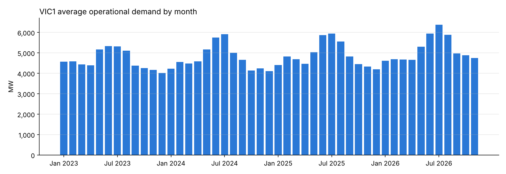

# NEM VIC1 price spike forecasting with battery dispatch evaluation

I built this project to develop a working knowledge of National Electricity Market (NEM) price
dynamics, dispatch and battery energy storage (BESS) operations, using public data and the kind of
tooling an energy trading desk uses.

To start with, I investigate **forecasting 5-minute spot prices in Victoria (VIC1)** 30 minutes and
4 hours ahead. Each forecast is a range (10th, 50th, 90th and 99th percentiles) plus the
probability that the price exceeds $300/MWh, the strike of a standard NEM cap contract. I then
investigate what those prices are worth to **a hypothetical grid battery**.

## Summary of outcomes so far

### Price forecasting

Models are evaluated walk-forward: train on everything up to a quarter, forecast that quarter,
roll forward. Ten quarters (Jan 2024 – Jun 2026, about 262,000 forecasts per horizon) are used for
development; Jul–Oct 2026 is held back as an untouched final test.

| Horizon | Model | Typical error (MAE, $/MWh) | Spike alarm quality (PR-AUC) |
|---|---|---|---|
| 30 min | Best simple baseline ("price stays where it is") | **24.90** | 0.357 |
| 30 min | LightGBM | 25.47 | **0.594** |
| 4 h | Best simple baseline | 65.48 | 0.057 |
| 4 h | LightGBM | **41.17** | **0.269** |

(PR-AUC: 1 is a perfect spike alarm; random guessing scores the spike rate, 0.009.)

- **4 hours ahead, the model clearly earns its keep:** typical error is 37 % lower than the best
  baseline, and it wins in all 10 quarters.
- **30 minutes ahead, "the price stays where it is" is very hard to beat.** The model wins in 7 of
  10 quarters but loses overall, because two volatile quarters dominate the totals.
- **Spike warnings are much better than any baseline at both horizons:** about 65 times better
  than random at 30 minutes and 30 times better at 4 hours.
- **Weak spot:** the 4-hour 80 % ranges contain the actual price only 73 % of the time; they are
  too narrow, especially in volatile periods.

### A hypothetical battery

| Parameter | Value |
|---|---|
| Power / energy | 100 MW / 200 MWh (2-hour battery) |
| Round-trip efficiency | 90 % |
| State-of-charge range | 10 %–90 % (160 MWh usable) |
| Daily reset | Starts and ends each day at 50 % |
| Degradation (wear) cost | $10 per MWh discharged (results also run at $0 and $20) |

Key assumptions (amongst others):
- **Price taker:** the battery's own dispatch does not move the price.
- **Energy arbitrage only:** no frequency control (FCAS) revenue, which in practice is a major
  income stream for batteries.
- **Simplified physics and grid:** constant efficiency, a linear wear cost, no network constraints
  or marginal loss factors; settled at the 5-minute regional price.
- **No simultaneous charging and discharging.** Without this rule, an optimiser exploits negative
  prices by doing both at once to "burn" energy through losses, which a real battery cannot do.

Outcomes over the 912 development days (Jan 2024 – Jun 2026), at $10/MWh wear cost:

| Strategy | Net revenue | Per MW per year | Share of perfect foresight | Cycles per day |
|---|---|---|---|---|
| Perfect foresight (knows each day's prices in advance) | $47.0 m | $188,000 | 100 % | 3.2 |
| Naive (same daily schedule every day, from past averages) | $18.8 m | $75,000 | **40 %** | 2.4 |

- **Battery value is concentrated in a few days.** The 5 best days earn 26 % of perfect-foresight
  revenue, and the best 10 % of days earn 43 %. Missing spike days costs more than months of
  ordinary trading.
- **A fixed daily routine captures about 40 % of the theoretical maximum** and loses money on 15 %
  of days.
- **Wear cost matters:** without it the optimiser cycles 4.9 times a day; at $10/MWh this falls to
  3.2, and at $20/MWh to 2.5.
- **Next:** a battery driven by the forecasts above, re-planning every 30 minutes, to measure how
  much of the gap between 40 % and 100 % the forecasts can close.

More detail will be added as the analysis progresses. Design decisions, all results and their
limitations are recorded in [`docs/design_notes.md`](docs/design_notes.md).

## Data

| Data | Source | Resolution | Period |
|---|---|---|---|
| Regional reference price and total demand, VIC1 | AEMO aggregated price and demand data | 5 min | 1 Jan 2023 – 31 Oct 2026 |
| Historical weather, Melbourne | Open-Meteo Historical Weather API (ERA5 reanalysis) | Hourly | Same |

Data is not committed to this repository. It is downloaded from the original sources and cached
locally as parquet (see *Quick start*).

### What the data looks like

Demand has a clean yearly cycle, peaking in winter (heating) at about 5,900–6,400 MW on a monthly
average basis. Demand alone does not explain price: winter 2025 demand was similar to winter
2024, yet June 2025 averaged $265/MWh, the dearest month in the data, driven by a small number of
very high-priced intervals.



The price distribution is the core of the problem. It has several peaks rather than one bell
curve: a sharp peak just above zero (the $5–$10 bucket alone holds 6.5 % of intervals), a cluster
of **negative** prices around −$60 to −$30 (22 % of all intervals are negative, mostly midday
solar; floor −$1,000/MWh), a broad hump of "normal" prices around $50–$130, and a long right tail:
0.8 % of intervals exceed $300/MWh, up to $19,070/MWh. A single "expected price" describes this
poorly, which is why the models forecast quantiles and a spike probability. The grey overflow
bars group everything below −$200 or at $400 and above (wider bars, holding many buckets' worth
of intervals), so every interval is counted.


Demand is far better behaved: a single peak around 4,300–4,400 MW with a right skew, from
1,225 MW (sunny middays, when rooftop solar offsets grid demand) to 10,784 MW.


Figures cover 1 Jan 2023 – 31 Oct 2026 (403,200 five-minute intervals) and are regenerated with
`uv run nemspike figures`.

## Quick start

```bash
uv sync --extra dev
```

```bash
uv run nemspike fetch-prices
```

```bash
uv run nemspike fetch-weather
```

```bash
uv run nemspike backtest --models baselines,lgbm_asinh,lgbm_none
```

```bash
uv run nemspike battery
```

```bash
uv run nemspike train-final --models lgbm_asinh
```

```bash
uv run mlflow ui --backend-store-uri sqlite:///mlflow.db
```

```bash
uv run pytest
```

```bash
uv run ruff check .
```

See `docs/design_notes.md` for design decisions and limitations.

### Saved results

- `reports/metrics/<stage>/`: metric tables for every model (pooled and per fold), as CSV.
- `results/predictions/dev/`: compact out-of-sample predictions of the default model
  (`lgbm_asinh`) for every development-fold origin, so plots and the battery evaluation can be
  reproduced without re-training (about 30 minutes). Regenerate everything with
  `uv run nemspike backtest --models baselines,lgbm_asinh,lgbm_none`.

## Data attribution and licences

- **AEMO.** Price and demand data © Australian Energy Market Operator (AEMO), used in accordance
  with AEMO's [Copyright Permissions Notice](https://www.aemo.com.au/privacy-and-legal-notices/copyright-permissions).
  Source: [Aggregated price and demand data](https://www.aemo.com.au/energy-systems/electricity/national-electricity-market-nem/data-nem/aggregated-data).
  This project is not affiliated with or endorsed by AEMO.
- **Open-Meteo.** [Weather data by Open-Meteo.com](https://open-meteo.com/), licensed under
  [CC BY 4.0](https://creativecommons.org/licenses/by/4.0/). Open-Meteo's free API is for
  non-commercial use only ([terms](https://open-meteo.com/en/terms)). Historical data is derived
  from the Copernicus Climate Change Service (C3S) ERA5 reanalysis. Data has been resampled and
  transformed into features for this project.

## Licence

Code: MIT.
