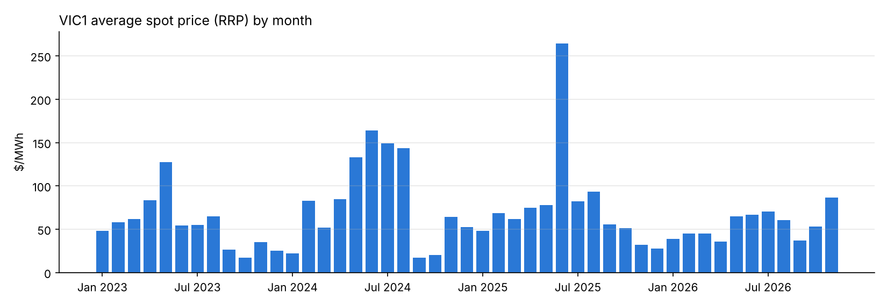
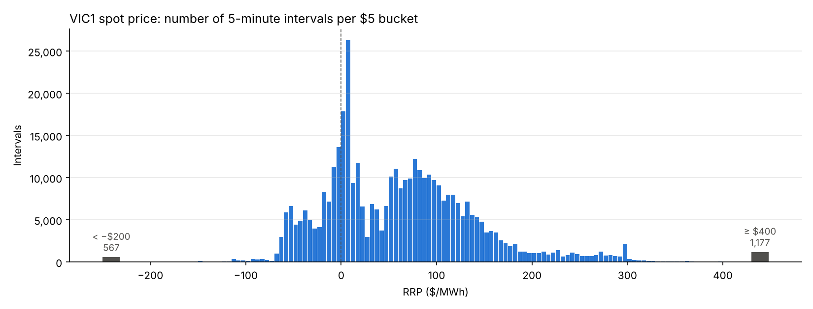

# NEM VIC1 price spike forecasting with battery dispatch evaluation

Probabilistic forecasts of the 5-minute regional reference price (RRP) in Victoria, a price
spike classifier, and a linear-programming battery model that measures how much of the
perfect-foresight arbitrage revenue the forecasts can capture.

> **Status:** work in progress. Results will be added only from reproducible, seeded runs.

## Data

| Data | Source | Resolution | Period |
|---|---|---|---|
| Regional reference price and total demand, VIC1 | AEMO aggregated price and demand data | 5 min | 1 Jan 2023 – 31 Oct 2026 |
| Historical weather, Melbourne | Open-Meteo Historical Weather API (ERA5 reanalysis) | Hourly | Same |

Data is not committed to this repository. It is downloaded from the original sources and cached
locally as parquet (see *Quick start*).

### What the data looks like

Monthly average prices swing from $17/MWh (October 2023) to $265/MWh (June 2025). Winters are
usually dearest; spring, with plenty of wind and solar and mild demand, is cheapest. A few
extreme intervals can dominate a month's average: June 2025 was driven by a small number of
very high-priced intervals, not a month of uniformly high prices.



Demand has a clean yearly cycle, peaking in winter (heating) at about 5,900–6,400 MW on a monthly
average basis. Demand alone does not explain price: winter 2025 demand was similar to winter
2024, yet June 2025 prices were far higher.


The price distribution is the core of the problem. It has several peaks rather than one bell
curve: the most common bucket is $0–$20 (16 % of intervals), 22 % of intervals are **negative**
(midday solar; floor −$1,000/MWh), there is a broad hump of "normal" prices around $60–$120, and a
long right tail: 0.8 % of intervals exceed $300/MWh, up to $19,070/MWh. A single "expected price"
describes this poorly, which is why the models forecast quantiles and a spike probability.
Overflow bars group the tails so that every interval is counted.



Demand is far better behaved: a single peak around 4,300–4,400 MW with a right skew, from
1,225 MW (sunny middays, when rooftop solar offsets grid demand) to 10,784 MW.


Figures cover 1 Jan 2023 – 31 Oct 2026 (403,200 five-minute intervals) and are regenerated with
`uv run nemspike figures`.

## Quick start

```bash
uv sync --extra dev
```

```bash
uv run nemspike fetch-prices
```

```bash
uv run nemspike fetch-weather
```

```bash
uv run pytest
```

```bash
uv run ruff check .
```

See `docs/design_notes.md` for design decisions and limitations.

### Saved results

- `reports/metrics/<stage>/`: metric tables for every model (pooled and per fold), as CSV.
- `results/predictions/dev/`: compact out-of-sample predictions of the default model
  (`lgbm_asinh`) for every development-fold origin, so plots and the battery evaluation can be
  reproduced without re-training (about 30 minutes). Regenerate everything with
  `uv run nemspike backtest --models baselines,lgbm_asinh,lgbm_none`.

## Data attribution and licences

- **AEMO.** Price and demand data © Australian Energy Market Operator (AEMO), used in accordance
  with AEMO's [Copyright Permissions Notice](https://www.aemo.com.au/privacy-and-legal-notices/copyright-permissions).
  Source: [Aggregated price and demand data](https://www.aemo.com.au/energy-systems/electricity/national-electricity-market-nem/data-nem/aggregated-data).
  This project is not affiliated with or endorsed by AEMO.
- **Open-Meteo.** [Weather data by Open-Meteo.com](https://open-meteo.com/), licensed under
  [CC BY 4.0](https://creativecommons.org/licenses/by/4.0/). Open-Meteo's free API is for
  non-commercial use only ([terms](https://open-meteo.com/en/terms)). Historical data is derived
  from the Copernicus Climate Change Service (C3S) ERA5 reanalysis. Data has been resampled and
  transformed into features for this project.

## Licence

Code: MIT.
