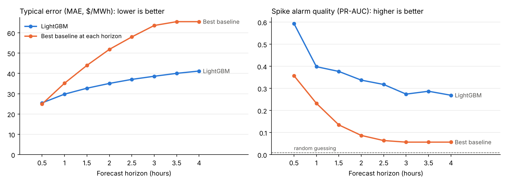
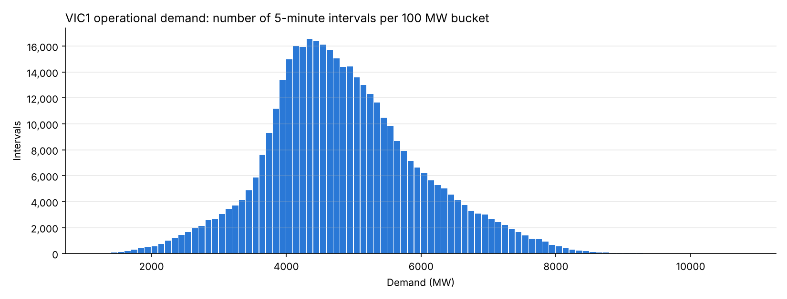

# NEM VIC1 price spike forecasting with battery dispatch evaluation

I built this project to develop a working knowledge of National Electricity Market (NEM) price
dynamics, dispatch and battery energy storage (BESS) operations, using public data and the kind of
tooling an energy trading desk uses.

To start with, I investigate **forecasting 5-minute spot prices in Victoria (VIC1)** 30 minutes and
4 hours ahead. Each forecast is a range (10th, 50th, 90th and 99th percentiles) plus the
probability that the price exceeds $300/MWh, the strike of a standard NEM cap contract. I then
investigate what those prices are worth to **a hypothetical grid battery**.

## Summary of outcomes so far

### Price forecasting

**Model:** LightGBM gradient-boosted decision trees, one model per forecast horizon. Quantile
regression gives the price range (on an asinh-transformed price, which tames the heavy tail and
handles negative prices), and a separate classifier gives the spike probability. Inputs are 74
features known at forecast time: recent prices and demand, calendar, sun position and weather.
Gradient boosting suits this tabular, mixed-feature problem with strong non-linear interactions
(for example time of day × recent volatility × temperature), retrains in about a minute per
fold, and has built-in quantile and classification objectives.

Models are evaluated walk-forward: train on everything up to a quarter, forecast that quarter,
roll forward. Ten quarters (Jan 2024 – Jun 2026, about 262,000 forecasts per horizon) are used for
development; Jul–Oct 2026 is held back as an untouched final test.

| Horizon | Model | Typical error (MAE, $/MWh) | Spike alarm quality (PR-AUC) |
|---|---|---|---|
| 30 min | Best simple baseline ("price stays where it is") | **24.90** | 0.357 |
| 30 min | LightGBM | 25.47 | **0.594** |
| 4 h | Best simple baseline | 65.48 | 0.057 |
| 4 h | LightGBM | **41.17** | **0.269** |

(PR-AUC: 1 is a perfect spike alarm; random guessing scores the spike rate, 0.009.)

- **4 hours ahead, the model clearly earns its keep:** typical error is 37 % lower than the best
  baseline, and it wins in all 10 quarters.
- **30 minutes ahead, "the price stays where it is" is very hard to beat.** The model wins in 7 of
  10 quarters but loses overall, because two volatile quarters dominate the totals.
- **Spike warnings are much better than any baseline at both horizons:** about 65 times better
  than random at 30 minutes and 30 times better at 4 hours.
- **Weak spot:** the 4-hour 80 % ranges contain the actual price only 73 % of the time; they are
  too narrow, especially in volatile periods.

Across every horizon from 30 minutes to 4 hours (in 30-minute steps), the model's advantage grows
with the horizon: from 60 minutes onwards it beats the best baseline in all 10 quarters at every
horizon, with typical error 15 % lower at 1 hour and 37 % lower at 4 hours.



### A hypothetical battery

| Parameter | Value |
|---|---|
| Power / energy | 100 MW / 200 MWh (2-hour battery) |
| Round-trip efficiency | 90 % |
| State-of-charge range | 10 %–90 % (160 MWh usable) |
| Operation | Continuous: charge carried overnight; 50 % at the start and end of each quarter |
| Degradation (wear) cost | $40 per MWh discharged ($0–60 sensitivity in the design notes) |

Key assumptions (amongst others):
- **Wear cost:** replacement cost of worn capacity ÷ lifetime energy delivered, using illustrative
  figures ($200,000 per MWh of cells ÷ (6,000 cycles × 80 % usable depth) ≈ $40/MWh).
- **Price taker, energy arbitrage only:** the battery does not move the price, and earns no
  frequency control (FCAS) revenue.
- **Simplified physics and grid:** constant efficiency, linear wear cost, no network constraints
  or loss factors; settled at the 5-minute regional price.
- **Forecast-driven battery plans on the expected price, not the median** (risk-neutral). Revenue
  is price × energy, so average revenue depends on the average price; the median ignores the
  spike tail and sits $9–12/MWh below realised prices on our forecasts.

Strategies compared:
- **Perfect foresight:** knows every actual price in advance. The theoretical maximum.
- **Forecast-driven:** every 30 minutes, plans the next 4 hours on the forecast expected price,
  carries out the first 30 minutes, then re-plans. Energy left at the end of each plan is valued
  using a "water value" curve: the typical marginal value of stored energy by time of day,
  weekday versus weekend, learned from earlier data.
- **Naive:** the same daily schedule every day (charge in the midday solar trough, discharge in
  the evening peak), optimised on past average prices.

Outcomes over 821 development days (Apr 2024 – Jun 2026), at $40/MWh wear cost:

| Strategy | Net revenue | Per MW per year | Share of perfect foresight | Loss-making days |
|---|---|---|---|---|
| Perfect foresight | $33.1 m | $147,000 | 100 % | < 1 % |
| **Forecast-driven** | **$15.6 m** | **$69,000** | **47 %** | **9 %** |
| Naive daily schedule | $15.2 m | $68,000 | 46 % | 18 % |

**Summary.** The forecast-driven battery generally outperformed the naive schedule: it did better
in 8 of 9 quarters (often by 10–17 percentage points of perfect foresight), on 61 % of individual
days, and halved the number of loss-making days. But on two extreme days in June 2025, with
prices up to about $15,000/MWh, it lost about $2.2 m relative to naive. Excluding just those two
days, it was $2.5 m ahead over the period; including them, only $0.35 m.

**Why.** On 26 June 2025, prices were already $180–400 at midday and reached $3,900–14,000 from
17:00 to 20:30. The forecasts saw an ordinary expensive afternoon: the 4-hour-ahead forecast for
17:00 had a median of $304 and a 99th percentile of about $2,000, against an actual $9,656. So the
battery made small trades around $300 and was empty when the spike arrived. The naive schedule
charged at midday regardless of price and happened to discharge into the spike. The spike
classifier *did* flag the risk (43 % probability at 13:00), but the battery does not yet use it.

**What could fix it (to be tested):**
1. Raise the value of stored energy when the forecast spike probability over the next few hours
   is high, so the battery holds charge on risky afternoons.
2. Add the spike probability × typical spike size to the planning price.
3. A simple reserve rule: keep at least a minimum charge whenever spike risk is high.
4. Better forecasts of spike *size* (the model sees the risk but badly under-estimates magnitude).

Battery value is concentrated in a few days: the 5 best days earn 30 % of perfect-foresight
revenue, and the best 10 % of days almost half. Getting the extreme days right matters more than
anything else.

More detail will be added as the analysis progresses. Design decisions, all results and their
limitations are recorded in [`docs/design_notes.md`](docs/design_notes.md).

## Data

| Data | Source | Resolution | Period |
|---|---|---|---|
| Regional reference price and total demand, VIC1 | AEMO aggregated price and demand data | 5 min | 1 Jan 2023 – 31 Oct 2026 |
| Historical weather, Melbourne | Open-Meteo Historical Weather API (ERA5 reanalysis) | Hourly | Same |

Data is not committed to this repository. It is downloaded from the original sources and cached
locally as parquet (see *Quick start*).

### What the data looks like

The price distribution is the core of the problem. It has several peaks rather than one bell
curve: a sharp peak just above zero (the $5–$10 bucket alone holds 6.5 % of intervals), a cluster
of **negative** prices around −$60 to −$30 (22 % of all intervals are negative, mostly midday
solar; floor −$1,000/MWh), a broad hump of "normal" prices around $50–$130, and a long right tail:
0.8 % of intervals exceed $300/MWh, up to $19,070/MWh. A single "expected price" describes this
poorly, which is why the models forecast quantiles and a spike probability. The grey overflow
bars group everything below −$200 or at $400 and above (wider bars, holding many buckets' worth
of intervals), so every interval is counted.


Demand is far better behaved: a single peak around 4,300–4,400 MW with a right skew, from
1,225 MW (sunny middays, when rooftop solar offsets grid demand) to 10,784 MW.



Figures cover 1 Jan 2023 – 31 Oct 2026 (403,200 five-minute intervals) and are regenerated with
`uv run nemspike figures`.

## Quick start

```bash
uv sync --extra dev
```

```bash
uv run nemspike fetch-prices
```

```bash
uv run nemspike fetch-weather
```

```bash
uv run nemspike backtest --models baselines,lgbm_asinh,lgbm_none
```

The forecast-driven battery needs forecasts at every dispatch horizon (30 minutes to 4 hours in
30-minute steps, `forecast.dispatch_horizons_minutes` in the config):

```bash
uv run nemspike backtest --models baselines,lgbm_asinh --horizons dispatch
```

```bash
uv run nemspike battery --degradation-costs 0,10,20,40,60
```

```bash
uv run nemspike battery-forecast
```

```bash
uv run nemspike train-final --models lgbm_asinh
```

```bash
uv run mlflow ui --backend-store-uri sqlite:///mlflow.db
```

```bash
uv run pytest
```

```bash
uv run ruff check .
```

See `docs/design_notes.md` for design decisions and limitations.

### Saved results

- `reports/metrics/<stage>/`: metric tables for every model (pooled and per fold), as CSV.
- `results/predictions/dev/`: compact out-of-sample predictions of the default model
  (`lgbm_asinh`) for every development-fold origin, written by
  `uv run nemspike snapshot-predictions`. Only the 30-minute and 4-hour horizons are committed so
  far, so forecast metrics at those horizons can be recomputed without re-training.
- `uv run nemspike battery-forecast` reads the full predictions under `artefacts/` if present and
  otherwise these snapshots, for all eight dispatch horizons. Until the six intermediate
  snapshots are committed it therefore needs the two `backtest` commands above; it also always
  needs the AEMO prices (`fetch-prices`), which are not committed.
- `battery_summary_forecast_deg40.csv` gives each strategy's net revenue minus the naive
  schedule's with a bootstrap 95 % interval (`net_vs_naive_time_of_day*` columns): for the
  headline forecast-driven battery, +$0.35 m with an interval of −$3.1 m to +$2.8 m.

## Data attribution and licences

- **AEMO.** Price and demand data © Australian Energy Market Operator (AEMO), used in accordance
  with AEMO's [Copyright Permissions Notice](https://www.aemo.com.au/privacy-and-legal-notices/copyright-permissions).
  Source: [Aggregated price and demand data](https://www.aemo.com.au/energy-systems/electricity/national-electricity-market-nem/data-nem/aggregated-data).
  This project is not affiliated with or endorsed by AEMO.
- **Open-Meteo.** [Weather data by Open-Meteo.com](https://open-meteo.com/), licensed under
  [CC BY 4.0](https://creativecommons.org/licenses/by/4.0/). Open-Meteo's free API is for
  non-commercial use only ([terms](https://open-meteo.com/en/terms)). Historical data is derived
  from the Copernicus Climate Change Service (C3S) ERA5 reanalysis. Data has been resampled and
  transformed into features for this project.

## Licence

Code: MIT.
