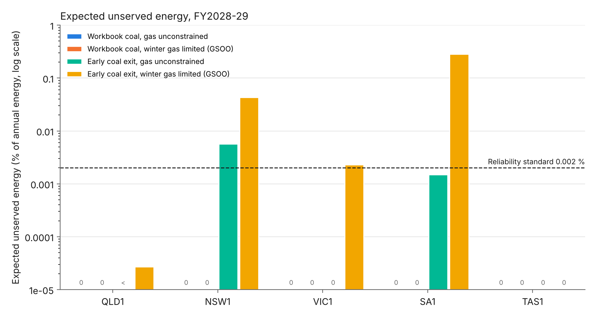
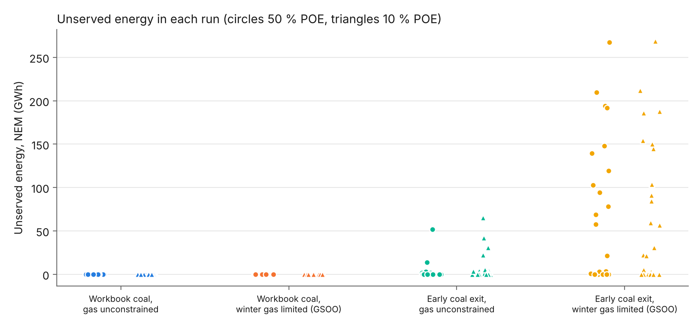

# NEM market and reliability model

A simplified five-region model of the National Electricity Market (NEM) in
[PyPSA](https://pypsa.org/), solved with the open-source [HiGHS](https://highs.dev/) solver. It
asks an ESOO-style question for **FY2028-29**: with the existing, committed and anticipated
fleet, is expected unserved energy within the reliability standard? It then asks how the answer
changes if coal retires earlier and if southern gas is tight in winter.

Inputs come from AEMO's ISP *Inputs, Assumptions and Scenarios Report* (IASR) workbook and ISP
demand, wind and solar traces. They are parsed into versioned tables committed in
[`inputs/`](inputs/).

**Status: v0.3.** Every element of the assessment is present, each in simplified form; the
simplifications are listed below. v0.3 moves to the final 2026 ISP workbook (v7.8), closes
Eraring on 30 April 2029, runs 13 weather years instead of one, and replaces the illustrative
gas cap with a southern winter gas balance built from the 2026 GSOO. See
[docs/design_notes.md](docs/design_notes.md) for the reasons behind each choice, and
[docs/data_needed.md](docs/data_needed.md) for the data sources.

## Results (v0.3)



**Expected unserved energy, FY2028-29** (% of regional annual energy; standard 0.002 %). In
brackets: how many of the 26 combinations of weather year and outage draw (13 × 2) have any
unserved energy.

| Region | Workbook coal, gas unconstrained | Workbook coal, winter gas limited (GSOO) | Early coal exit, gas unconstrained | Early coal exit, winter gas limited (GSOO) |
|---|---|---|---|---|
| QLD1 | 0 (0) | 0 (0) | 0.0000002 (1) | 0.000017 (1) |
| NSW1 | 0 (0) | 0 (0) | **0.0057** (10) | **0.043** (17) |
| VIC1 | 0 (0) | 0 (0) | 0 (0) | **0.0023** (2) |
| SA1 | 0 (0) | 0 (0) | 0.0015 (4) | **0.28** (15) |
| TAS1 | 0 (0) | 0 (0) | 0 (0) | 0 (0) |

Bold: above the reliability standard. Full results: [`results/eue.csv`](results/eue.csv) and,
for every run, [`results/runs.csv`](results/runs.csv).

**Read these as optimistic.** The Tasmanian and Snowy water plan is made with full knowledge of
the year's weather and breakdowns, so the dams save water for exactly the weeks that need it.
Planning on expected conditions instead is the next change (see Assumptions).

### Findings

1. **Workbook coal: within the standard, with or without the GSOO gas limit.** No region has
   unserved energy in any of the 52 runs per scenario. With the final workbook's fleet (Eraring
   until April 2029, 5.9 GW more batteries than the draft), coal and storage carry winter and
   gas-powered generation rarely runs: the busiest winter day burns 240 TJ on average across
   runs, against at least 588 TJ/day available to power stations under the GSOO balance. The
   unconstrained busiest day exceeds that in only 5 of 52 runs.
2. **Early coal exit alone pushes NSW above the standard** (0.0057 %, unserved energy in 10 of
   26 weather-year and outage-draw combinations); SA is just inside it. Gas fills most of the gap: southern gas burn
   rises from 1.4 PJ to 130 PJ a year, and the busiest winter day to 1,290 TJ on average
   (up to 1,690 TJ), above the top of the GSOO's 700–1,200 TJ/day range.
3. **The two risks compound.** Gas that is not needed with the workbook's coal becomes
   essential once coal exits early. With both, NSW reaches 0.043 % (7.6 times the early-exit
   case alone), SA 0.28 % (190 times) and VIC moves above the standard. The gas limit on its own
   does nothing; coal exit on its own is a modest breach; together they are a large one. That
   interaction is what an integrated gas–electricity assessment exists to catch.
4. **The weather year matters as much as the scenario.** In the combined case, NEM-wide
   unserved energy ranges from 0 (2016, 2021, 2023 weather) to 240 GWh (2018 weather), averaged
   over outage draws and POE levels. One weather year, as in v0.2, can miss or overstate the
   risk.



**What changed from v0.2.** v0.2 used the draft workbook, one weather year (2018) and an
illustrative cap of 195 TJ/day. v0.3's results are lower in every stressed case:

| Change | Effect |
|---|---|
| Final workbook (v7.8) | Eraring runs until 30 April 2029 (+2.9 GW in summer and autumn), +5.9 GW of batteries, cheaper gas. Gas-powered generation in the base case falls from 9 PJ to 1.4 PJ a year |
| GSOO gas balance replaces the 195 TJ/day cap | 588–1,200 TJ/day for power stations, depending on the day, instead of 195; with workbook coal the limit rarely binds |
| 13 weather years | 2018 was one of the harder years (the worst in the combined case); averaging across years lowers EUE |

The ordering of the scenarios, and the compounding of coal and gas risk, hold in both versions.

10 % and 50 % POE demand give similar results. The 10 % POE trace differs from the 50 % trace
only at peaks, with the same annual energy, while the shortfalls here are multi-day energy
shortages in winter.

### Comparison with the 2026 ESOO

AEMO's 2026 ESOO, FY2028-29, committed and anticipated developments (from the ESOO results
workbook, parsed into [`inputs/esoo-2026/unserved_energy.csv`](inputs/esoo-2026/unserved_energy.csv)):

| Region | 2026 ESOO EUE (%) | This model, base case (%) |
|---|---|---|
| QLD1 | 0 | 0 |
| NSW1 | 0.000002 | 0 |
| VIC1 | 0.00022 | 0 |
| SA1 | 0 | 0 |
| TAS1 | 0.0000002 | 0 |

Both find every region within the standard. The ESOO's small non-zero values (largest in
Victoria, about a tenth of the standard) come from far more outage draws, long-duration
outages, intra-regional network limits and no perfect foresight; with 26 runs per POE level
this model cannot resolve risk that small. The model is consistent with the ESOO, not a
replication of it.

### Sense-check against the 2026 GSOO

| Quantity | This model | Published | Source |
|---|---|---|---|
| Gas available to southern power stations, winter 2029 1-in-2 peak day | About 590 TJ/day (the balance's minimum, cold days) | Derived from GSOO production, northern supply, storage and non-power demand | [`config/gas_balance.yaml`](config/gas_balance.yaml) |
| Busiest winter day, southern gas-powered generation, workbook coal | 240 TJ/day (mean across runs; up to 660) | 700 to 1,200 TJ/day historically (2025 GSOO) | [2025 GSOO webinar](https://www.aemo.com.au/-/media/files/gas/national_planning_and_forecasting/gsoo/2025/2025-gsoo-webinar-presentation.pdf) |
| Timing of southern peak-day gas risk | Winter 2028 and June 2029 modelled | Peak-day shortfall risk from 2029 | [2026 GSOO](https://www.aemo.com.au/-/media/files/gas/national_planning_and_forecasting/gsoo/2026/2026-gas-statement-of-opportunities.pdf) |

**The model under-runs gas.** Its base case burns far less gas for power than the NEM does
today. Dispatch is by short-run cost alone, with perfect foresight and no network limits inside
regions, so coal, storage and hydro displace gas wherever they can. In practice gas runs for
system strength, network support, contracts and forecast uncertainty. This is the main reason
the workbook-coal gas limit does not bind here; a model that ran gas more would find the GSOO
limit tighter.

## Method

| Element | Representation (v0.3) |
|---|---|
| Regions | QLD1, NSW1, VIC1, SA1, TAS1, one bus each |
| Interconnectors | Seven inter-regional flow paths with seasonal forward and reverse limits (notional transfer limits plus uplifts from committed network projects); no losses |
| Demand | Hourly operational demand (sent out, as modelled), Step Change scenario, 10 % and 50 % POE, for each of 13 weather reference years (2011–2023) |
| Fleet | Existing, committed and anticipated units (ESOO definition), 610 units from the final 2026 ISP workbook; closures from the workbook, with Eraring closing on 30 April 2029 (2026 GSOO) |
| Thermal | Aggregated by power station; short-run marginal cost = fuel price × heat rate + variable O&M; seasonal ratings; ramp rates from the workbook |
| Minimum running levels | Coal and combined-cycle gas: workbook minimum stable levels (coal 30–51 % of capacity) and assumed minimum up and down times (coal 12 h / 8 h, CCGT 4 h / 4 h), as a linear "share of units online" per station; checked against exact per-unit on/off decisions |
| Wind and solar | Regional capacity factors, built from each unit's own project trace where its name matches (81–100 % of capacity), otherwise the regional mean |
| Storage | Batteries by region, pumped hydro by station (Wivenhoe, Shoalhaven, Kidston), workbook power and energy |
| Hydro | Tasmania and Snowy as seasonal storage: Tasmanian monthly inflows (GWh) from the workbook for the weather year, Snowy's monthly pattern from the workbook scaled to an assumed 13 % capacity factor; storage 14,400 GWh (Tasmania) and one year's output (Snowy), starting and ending the year half full, never below 20 %. Smaller schemes: flat inflow, weekly storage |
| Dispatch | Two stages: a whole-year solve plans Tasmanian and Snowy storage; weekly windows then dispatch, with batteries and pumped hydro returning to their starting level each week |
| Outages | Monte Carlo, unit by unit: two-state Markov chains for full and partial forced outages, from workbook rates and repair times; 2 draws per weather year and POE level (26 per POE level per scenario), with the same draws in every scenario |
| Reliability | EUE = 0.304 × (10 % POE) + 0.696 × (50 % POE), as % of regional annual energy, against the 0.002 % standard |
| Gas | Daily cap on gas burnt by NSW, VIC, SA and TAS gas-powered generation in June to August (limited-gas cases), from the 2026 GSOO southern balance: production + northern supply + storage withdrawal − demand excluding power generation, with colder days leaving less for power stations ([sources](config/gas_balance.yaml)) |

### Scenarios (2 × 2)

| | Gas unconstrained | Tight winter gas |
|---|---|---|
| **Workbook coal closures** | Base case | Gas cap only |
| **Early coal exit** | Gladstone, Callide B, Bayswater and Vales Point B (5.7 GW) closed before the year | Both |

## Assumptions and limitations

These matter for interpreting the numbers. Most of them make the model **optimistic** about
reliability.

* **Thirteen weather years, two outage draws each.** The ESOO uses more outage draws; with
  26 runs per POE level, small EUE values carry wide sampling error. Weather years are the
  2024 ISP traces (2011–2023).
* **Perfect foresight:** inside each week for dispatch, and over the whole year for the
  Tasmanian and Snowy water plan. Real operators plan water without knowing the year's weather
  or breakdowns. The next step is to plan on expected conditions (average availability, other
  weather years) and treat the plan as a target the dispatch may depart from at a cost.
* **Unit commitment is approximate:** a linear "share of units online" per station, with
  assumed minimum up and down times and no start-up costs. On a tight week it matches exact
  per-unit decisions; on/off detail matters more for cost than for unserved energy.
* **No long-duration outages** (a unit out for months) and no intra-regional network limits.
* **Hydro storage assumptions:** Snowy's annual energy, its storage size, and the 50 %
  starting level and 20 % drought floor for both schemes are assumptions (the workbook gives
  Tasmanian inflows but not storage sizes or operating rules).
* **Gas under-runs.** Dispatch by short-run cost alone leaves gas-powered generation far below
  what the NEM burns today (see the GSOO sense-check), so gas limits bite less than they would.
  Scenario comparisons are more reliable than absolute levels, because every scenario uses the
  same weather years and outage draws.
* **Gas balance from charts and interpolation:** several GSOO figures are read from charts
  (about ±25 TJ/day) and 2028–29 demand is interpolated between the GSOO's 2026 and 2030
  values. Storage running down over a winter, and 1-in-20 peak gas demand, are not modelled.
* **Inputs:** the final 2026 ISP workbook (v7.8, June 2026); the traces are from the 2024 ISP.
  Gladstone also closes in 2029 but no date is published in the sources used, so it runs all
  year.

## Reproduce

From this folder:

```bash
uv sync --package nemmodel --extra dev
```

```bash
uv run nemmodel fetch-weather --first 2011 --last 2023
```

```bash
uv run nemmodel study
```

```bash
uv run nemmodel figures
```

The processed weather traces are committed, so `fetch-weather` is only needed to rebuild them
(it downloads about 1.7 GB per weather year and keeps about 2 MB).

`nemmodel study` runs 208 one-year dispatches (4 scenarios × 2 POE levels × 13 weather years ×
2 outage draws) across three processes, which takes about 5 hours (each process needs up to
about 3 GB of memory). Each finished run is saved to `results/runs_partial.jsonl`, so an
interrupted study resumes where it stopped; `--max-minutes 100` stops starting new runs after
100 minutes, for machines that limit how long a job may run. Saved runs carry a fingerprint of
the configuration and inputs, and runs from a different setup are not reused. The seed is fixed
in [`config/assumptions.yaml`](config/assumptions.yaml), so reruns give the same results. To
rebuild the input tables from a workbook:

```bash
uv run nemmodel build-inputs path/to/workbook.xlsm --label final-2026-isp
```

Tests use synthetic data and the committed inputs; no download is needed:

```bash
uv run pytest
```

## Layout

```
config/assumptions.yaml   modelling assumptions not in the workbook
inputs/<version>/         versioned unit and interconnector tables, with a manifest (source, hash)
src/nemmodel/
  inputs.py               IASR workbook -> unit and interconnector tables
  traces.py               ISP traces -> hourly demand and wind/solar capacity factors
  weather.py              download and reduce weather reference years
  gas.py                  southern winter gas balance (2026 GSOO)
  benchmarks.py           2026 ESOO unserved energy for comparison
  outages.py              Monte Carlo forced outages
  network.py              PyPSA network, windowed solve, gas constraint
  study.py                2 x 2 scenario study and EUE
  figures.py, cli.py
results/                  study outputs (CSV)
docs/                     design notes and figures
```

## Related work

[ISPyPSA](https://github.com/Open-ISP/ISPyPSA) (UNSW CEEM, the openISP project) is an
open-source PyPSA model of the ISP's capacity expansion. This project uses openISP's
[`isp-workbook-parser`](https://github.com/Open-ISP/isp-workbook-parser) and
[`isp-trace-parser`](https://github.com/Open-ISP/isp-trace-parser), and its data mirror, but
addresses a different question: short-term reliability with a gas coupling, rather than
long-term investment.

## Data and attribution

Inputs are derived from AEMO's IASR workbook and ISP traces, © AEMO, used under
[AEMO's copyright permissions](https://www.aemo.com.au/privacy-and-legal-notices/copyright-permissions),
via the openISP mirror, and from AEMO's 2026 ESOO and 2026 GSOO. Processed input tables are
committed; raw traces are downloaded by `nemmodel fetch-weather` and are not committed.
